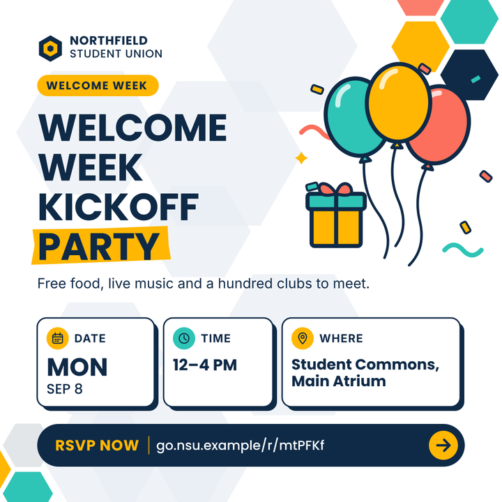
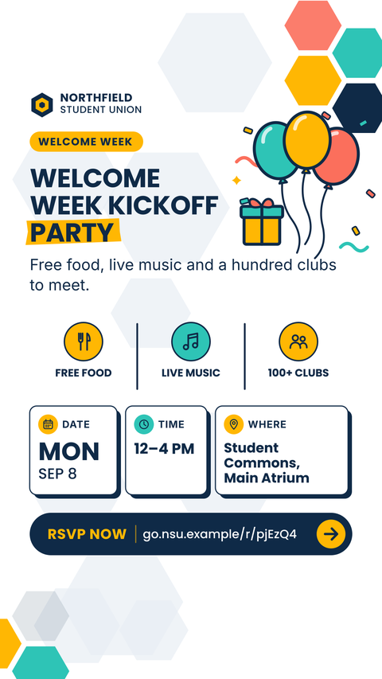
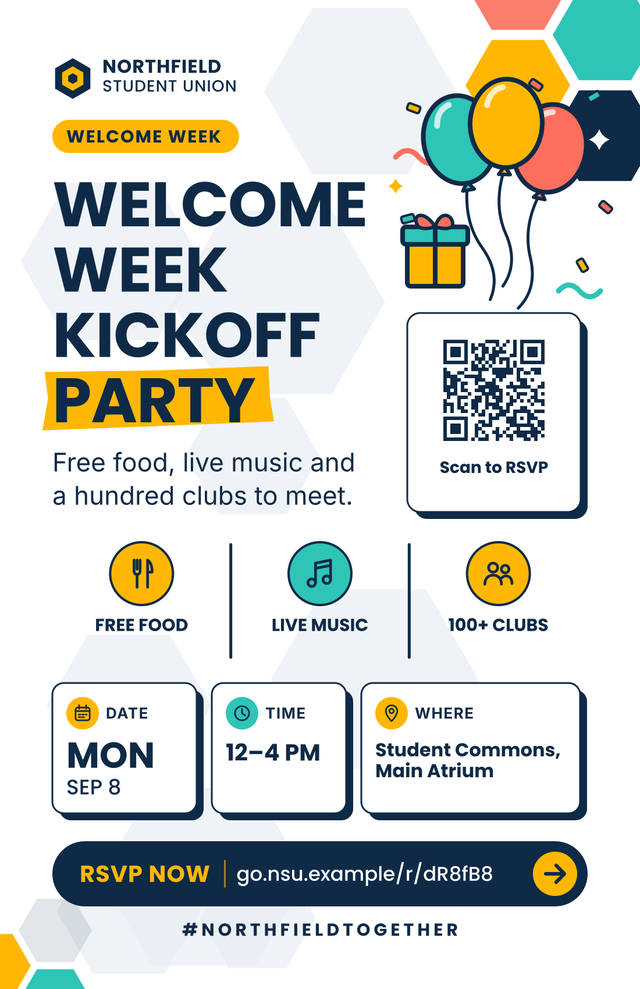
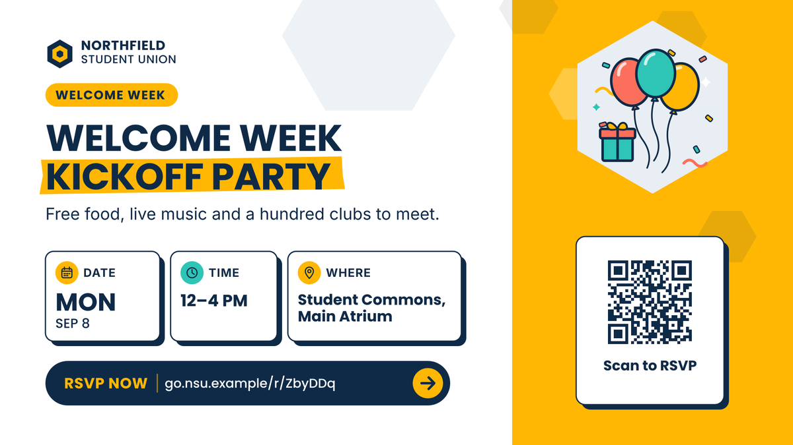
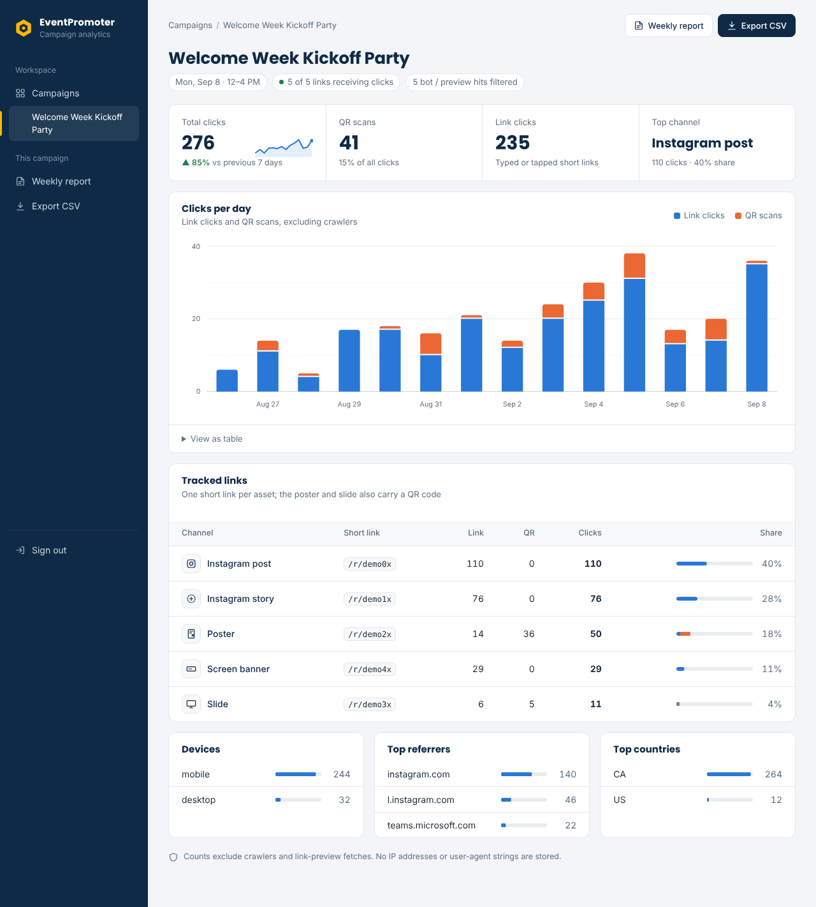

# EventPromoter

Turn **one event brief** into a matched, on-brand campaign: Instagram post, story, 11×17 poster (print-ready PDF), presentation slide and digital-screen banner. Every asset gets its **own tracked short link** (and a **QR code** on the poster and slide), so you can see which channel actually brought people in. A built-in **brand linter** checks each asset before it goes out.

Concept project, built around a fictional sample brand ("Northfield Student Union"). Swap `brand/brand.json` for any organisation's palette, fonts and copy limits.

| Post | Story | Poster (QR + short link) |
|---|---|---|
|  |  |  |




### Analytics dashboard


## How I'd use this at SSF

*A concept project: not affiliated with SSF, and the sample brand is fictional.*

Student-union marketing means announcing the same event in several places, each with its own size, brand rules and way of measuring results. EventPromoter is my take on handling the repetitive part of that quickly, so more time goes to the creative work.

- **One brief, five matching assets.** Event details go in once. The Instagram post, story, poster, slide and screen banner come out consistent, so nobody resizes and retypes the same text.
- **Brand checks before anything goes out.** The linter flags low contrast, off-palette colours, wrong fonts, text running off the edge, and text hidden under Instagram's story overlays, so reviewers can spend their time on ideas instead of catching mistakes.
- **Know which channel worked.** Every asset has its own short link, and the poster and slide also carry a QR code. Clicks and scans show up by channel on the dashboard, next to whatever the social platforms report.
- **Reports that paste straight in.** A weekly summary (totals, top channel, change from the previous period) is one request away, ready for the manager's update.
- **A companion, not a replacement.** Creative design would still happen in tools like Canva or Adobe, and scheduling in a tool like Hootsuite. This covers the layout, consistency and tracking work around them.

**Not built yet:** post scheduling, a content calendar and a post-event survey (see the roadmap below).

## Quick start

```bash
npm install
node src/cli.js examples/kickoff.json                      # assets only
node src/cli.js examples/kickoff.json --base-url https://go.example.org   # + tracked links and QR codes
node src/cli.js examples/bad-brief.json --no-fail          # watch the linter catch an off-brand design
npm test
```

A brief is plain JSON: `category, title, tagline, date, time, location, cta, link, accent` (`gold | teal | coral`), plus `destination` (the full https URL tracked links lead to) and these optional fields:

| Field | What it does |
|---|---|
| `theme` | `"light"` (white page, navy type) or `"dark"` (navy page, illustration on a light hexagon badge). Default `light`. |
| `highlights` | Up to three short selling points, e.g. `["Free food", "Live music", "100+ clubs"]`. Shown as an icon row on the story and poster; icons are picked from the words (food, music, dogs, prizes...) or set with `{ "text": "...", "icon": "gift" }`. |
| `art` | Force an illustration: `megaphone, party, mic, heart, box, books`. Otherwise it is picked from the category/title (Welcome Week → balloons, Arts → mic, Wellness → heart, Food drive → donation box, Workshops → books, anything else → megaphone). |
| `qrCaption` | Text under the QR code on the poster and slide. |

Needs `rsvg-convert` for the PDF.

## How it works

**Design side**
- **Layout engine, zero runtime deps.** `src/text.js` measures text from real per-glyph advance widths (`tools/gen-metrics.py` extracts them from the brand fonts), so it can wrap and *fit* copy to a box exactly. No DOM, no canvas, no font loading.
- **Templates → SVG.** Three layouts cover the five formats. The visual language follows real student-union posts: heavy all-caps titles with a hand-painted highlighter swatch on the last line, flat outlined illustrations chosen from the event category, honeycomb hexagons, an icon row of highlights, and date / time / location cards with hard offset shadows (the date card leads with the weekday). All artwork (`src/art.js`) is vector, deterministic and drawn in brand colours only.
- **Brand linter** (`src/lint.js`) inspects the exact geometry that was rendered: WCAG contrast, off-palette colours, non-brand typefaces, text overflow, platform safe zones (e.g. Instagram story UI), minimum legible size, copy length, and QR size/quiet-zone/safe-area.
- **QR encoder from scratch** (`src/qr.js`): byte mode, error correction M, versions 1-10, all 8 masks. `npm run verify:qr` renders codes at 12 lengths and 3 print sizes and decodes them with OpenCV; the test suite also decodes the QR out of the finished poster and slide PNGs.

**Tracking side** (`worker/`, Cloudflare Worker + D1)
- `GET /r/:code` logs the click and 302-redirects to the destination with UTM parameters added (existing ones are never overwritten). QR scans are told apart from typed links.
- Crawlers and link-preview fetches (Slack, WhatsApp, Facebook...) are detected and **excluded** from counts, but reported, so a pasted link doesn't inflate numbers.
- **Privacy:** no IP address and no raw user-agent string is ever stored, only day, device class, country, referrer *host*, and QR-vs-link.
- **Admin dashboard** (`/dashboard`): sidebar app shell in the brand navy and gold, a campaign list with totals, and per campaign a KPI band (clicks with a 14-day sparkline and week-over-week change, QR share, top channel), clicks per day, a tracked-links table (short code, link vs QR, share of clicks per asset) and device / referrer / country breakdowns. Every chart has a table view; light and dark themes follow the system; responsive down to phone width; no external fonts, scripts or inline styles, so the strict CSP still holds. Chart colours come from a palette validated for colour-blind separation and contrast.
- **Reporting:** `/api/campaigns/:id/report.md?days=7` returns a paste-ready weekly summary with change vs the previous period; `daily.csv` for spreadsheets.
- **Security:** admin routes fail closed (no `ADMIN_TOKEN` = everything denied), the session cookie holds a hash rather than the token, constant-time comparison, strict CSP with per-response nonces, all dynamic output HTML-escaped.

## Deploy the tracking Worker

```bash
npx wrangler d1 create eventpromoter                       # paste database_id into worker/wrangler.toml
npx wrangler d1 execute eventpromoter --remote --file=worker/schema.sql
npx wrangler secret put ADMIN_TOKEN --config worker/wrangler.toml
npm run deploy:worker

# per campaign:
node src/cli.js examples/kickoff.json --base-url https://<your-worker-domain>
npx wrangler d1 execute eventpromoter --remote --file=out/kickoff/links.sql
```

The CLI saves each campaign's link codes in `links/<campaign>.json` and **reuses them on every re-run**, so a poster that is already printed never changes link. Commit that folder in your own deployment (it is git-ignored here because the examples use a fake domain).

**Status:** the Worker's logic is tested end to end against SQLite standing in for D1 (`npm test`, including CLI → `links.sql` → database → redirect). `wrangler deploy` itself has not been run against a real Cloudflare account yet.

## Project layout

```
src/        layout engine, templates, artwork + icons, linter, QR encoder, link helpers, stats queries, CLI
worker/     Cloudflare Worker, D1 schema, admin dashboard renderer
brand/      brand.json (palette, fonts, copy limits)
examples/   sample briefs (+ one deliberately off-brand)
tools/      font-metrics generator, QR verifier, demo-dashboard renderer
test/       29 tests (layout, design, linter, QR, Worker, auth, end to end)
```

## Roadmap

- [ ] Post-event survey with automatic summary
- [ ] Content calendar view (when each asset is scheduled to go out)
- [ ] `.pptx` export for the slide
- [ ] Linter rule for text sitting on busy artwork
